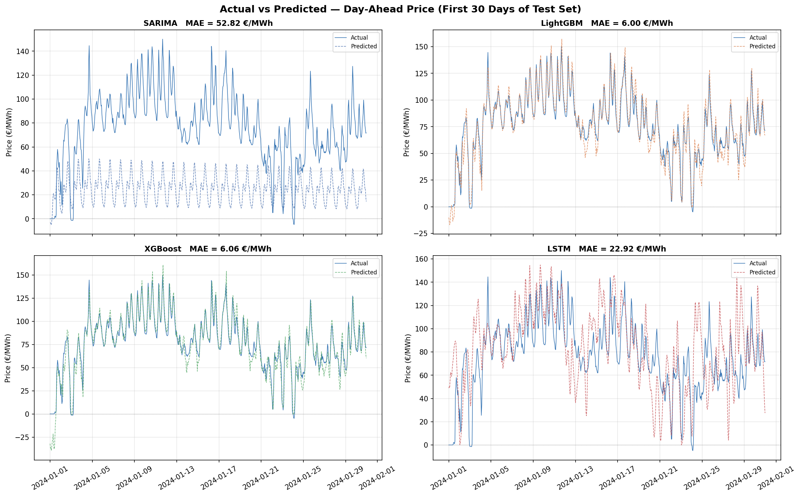
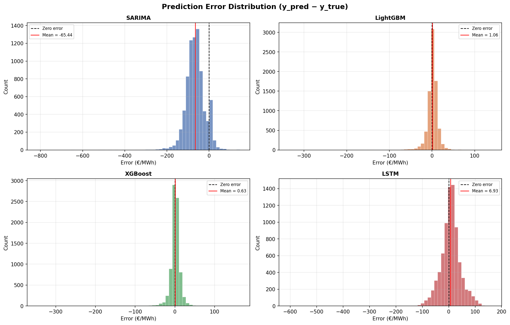
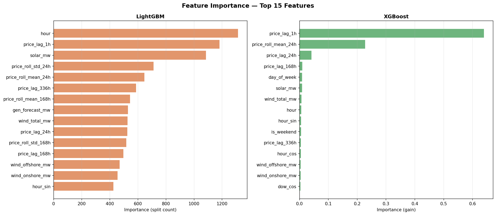
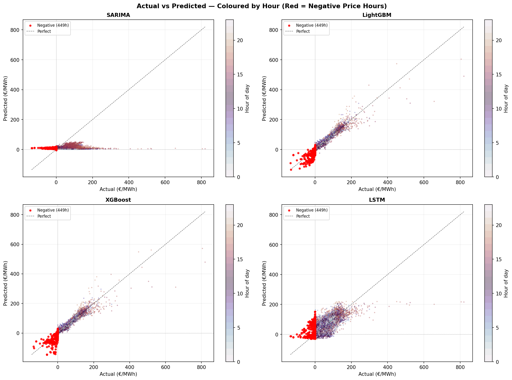

# EPEX Price Forecast Benchmark

> Comparing SARIMA, LightGBM, XGBoost, and LSTM for German day-ahead electricity price forecasting using real ENTSO-E DE-LU data (2022–2024).


---

## Results

> Trained on 2022–2023 (17,185 hours), tested on 2024 (8,040 hours). Strict temporal split — no shuffling, no leakage.

| Model | MAE (€/MWh) | RMSE (€/MWh) | Train Time |
|---|---|---|---|
| **XGBoost** | **8.60** | 15.50 | 1.7s |
| LightGBM | 8.69 | **14.93** | 0.7s |
| LSTM | 14.55 | 23.39 | 60.3s |
| SARIMA | 68.27 | 80.88 | 19.6s |

**XGBoost achieved 87.4% lower MAE than the SARIMA baseline** in 1.7 seconds of training.
LightGBM matched it within 0.09 €/MWh and achieved the lowest RMSE.
LSTM trained for 60 seconds and underperformed both tree models by 69%.

> **Note on MAPE:** Not reported as a primary metric. The 2024 test set contains 449 negative-price hours (5.6%), where `|y_true|` is near zero, causing MAPE to diverge to 774–1134%. MAE and RMSE are the reliable metrics for this dataset.

---

## Plots

### 1 — Actual vs Predicted (First 30 Days of Test Set)



SARIMA (MAE = 52.82 €/MWh on this window) flatlines — it cannot track the sharp intraday spikes and completely misses the price level after mid-January. LightGBM (6.00 €/MWh) and XGBoost (6.06 €/MWh) track actual prices closely, capturing both the intraday cycle and multi-day price movements. LSTM (22.92 €/MWh) captures the broad shape but shows excessive smoothing, missing peaks and undershooting spikes.

---

### 2 — Prediction Error Distribution



- **SARIMA** — Mean error = **−65.44 €/MWh**. Massively left-skewed: it systematically underpredicts by hundreds of €/MWh during high-price events. Errors range from −800 to near 0.
- **LightGBM** — Mean error = **+1.06 €/MWh**. Tight, near-zero-centered distribution. A slight positive bias (tends to overpredict slightly).
- **XGBoost** — Mean error = **+0.63 €/MWh**. The tightest distribution of all four models, nearly perfectly centered at zero.
- **LSTM** — Mean error = **+6.93 €/MWh**. Wider than both tree models, with a long left tail indicating it undershoots large price spikes.

---

### 3 — Feature Importance (Top 15)



The two tree models agree on the most informative features but weight them differently:

| Rank | LightGBM | XGBoost |
|---|---|---|
| #1 | `hour` | `price_lag_1h` (gain ≈ 0.63 — dominant) |
| #2 | `price_lag_1h` | `price_roll_mean_24h` |
| #3 | `solar_mw` | `price_lag_24h` |
| #4 | `price_roll_std_24h` | `price_lag_168h` |
| #5 | `price_roll_mean_24h` | `day_of_week` |

LightGBM uses `hour` and `solar_mw` heavily — it exploits the intraday solar generation pattern directly. XGBoost is dominated by `price_lag_1h` (gain 0.63), suggesting it leans more on pure price momentum. Both agree that rolling statistics (`price_roll_mean_24h`, `price_roll_std_24h`) and multi-day lags are critical second-tier features.

---

### 4 — Negative Price Analysis



Scatter of actual vs predicted price coloured by hour of day (twilight colormap, 0–23). Red markers = the **449 negative-price hours** in the 2024 test set (5.6%).

- **SARIMA**: all predictions collapse near zero regardless of actual price — it has no way to model extreme price regimes. Red (negative) hours are predicted at ~0 €/MWh.
- **LightGBM & XGBoost**: tight diagonal alignment across the full price range (−500 to +871 €/MWh). Both partially predict into negative territory during true negative-price hours, though they underestimate the depth of the dips.
- **LSTM**: more scattered, especially at high actual prices. The colormap shows it overpredicts low-hour (nighttime) prices and underpredicts daytime peaks.

---

## Dataset

**Source:** [ENTSO-E Transparency Platform](https://transparency.entsoe.eu) via [`entsoe-py`](https://github.com/EnergieID/entsoe-py)
**Bidding zone:** DE-LU (Germany + Luxembourg)
**Raw rows fetched:** 25,561 hourly observations (2022-01-01 – 2024-11-30)
**After feature engineering:** 25,225 rows (first 336h dropped as lag warm-up)
**Train set:** 17,185 rows | **Test set:** 8,040 rows
**Negative price hours in test:** 449 (5.6%)
**Price stats:** Mean 136.82 €/MWh · Std 116.80 €/MWh · Min −500 €/MWh · Max 871 €/MWh

### Series fetched from ENTSO-E

| Series | ENTSO-E Query | Status |
|---|---|---|
| Day-ahead prices | `query_day_ahead_prices` | ✅ available |
| Wind onshore forecast | `query_wind_and_solar_forecast` | ✅ available |
| Wind offshore forecast | `query_wind_and_solar_forecast` | ✅ available |
| Solar forecast | `query_wind_and_solar_forecast` | ✅ available |
| Generation forecast | `query_generation_forecast` | ✅ available |
| Load forecast | `query_load_forecast` / `query_load` | ❌ unavailable for DE_LU via API |

> **Load data note:** ENTSO-E does not expose load data for the DE-LU bidding zone through the `entsoe-py` client. The pipeline handles this gracefully — `load_mw`, `residual_load_mw`, `renewable_share`, and their lags are automatically dropped if unavailable. The benchmark ran on **23 features** instead of the designed 28.

---

## Feature Engineering

**23 features** used in this run (5 load-dependent features auto-dropped — see above).

### Renewable generation
- `wind_total_mw` = `wind_onshore_mw + wind_offshore_mw`
- `wind_onshore_mw`, `wind_offshore_mw`, `solar_mw`, `gen_forecast_mw`

### Cyclical time encoding
`hour=23` and `hour=0` are numerically distant but temporally adjacent. Sin/cos wraps each cycle so models see the continuity:

| Feature | Formula |
|---|---|
| `hour_sin`, `hour_cos` | sin/cos(2π · hour / 24) |
| `dow_sin`, `dow_cos` | sin/cos(2π · day\_of\_week / 7) |
| `month_sin`, `month_cos` | sin/cos(2π · month / 12) |

Also kept as integers: `hour`, `day_of_week`, `month`, `is_weekend`

### Price lags
| Feature | Lag |
|---|---|
| `price_lag_1h` | 1 hour — short-term momentum |
| `price_lag_24h` | 24 hours — same hour yesterday |
| `price_lag_168h` | 168 hours — same hour last week |
| `price_lag_336h` | 336 hours — same hour two weeks ago |

### Rolling statistics (shift-1 to prevent leakage)
| Feature | Window |
|---|---|
| `price_roll_mean_24h`, `price_roll_std_24h` | 24-hour |
| `price_roll_mean_168h`, `price_roll_std_168h` | 168-hour |

---

## Domain Context

EPEX SPOT is the pan-European power exchange where electricity for the next day is traded in hourly blocks through a uniform-price auction that clears once per day at noon. In the German-Luxembourg (DE-LU) bidding zone, accurate day-ahead price forecasts are critical for energy traders, grid operators, and large consumers: a 1 €/MWh improvement in forecast accuracy can translate to millions of euros in annual procurement or dispatch savings. The 2022–2024 period covered here is a demanding test bed — it spans the energy crisis of 2022 (prices exceeding 800 €/MWh during the gas supply shock), the gradual normalisation through 2023, and the increasingly frequent negative price events of 2024 driven by expanding solar capacity.

---

## Key Insights

- **XGBoost and LightGBM dominated** because day-ahead price formation is a tabular regression problem. `price_lag_1h` alone accounts for 63% of XGBoost's predictive gain — the strongest single signal in the dataset. LightGBM spreads importance more broadly across `hour`, `solar_mw`, and rolling statistics, making it slightly more robust to lag feature noise. Both tree models achieve near-zero mean error (+0.63 and +1.06 €/MWh respectively), indicating essentially unbiased predictions.

- **SARIMA failed structurally**, not just numerically. Its mean prediction error is −65 €/MWh — it systematically underpredicts by large margins because ARIMA cannot model the regime shifts caused by renewable supply shocks and gas price pass-through that dominated 2022–2024. An ARIMA trained on 2022 crisis prices predicts crisis-level prices for 2024 normalised conditions and vice versa.

- **LSTM underperformed despite 60 seconds of training** because the key temporal patterns are already explicit in the lag features. With `price_lag_24h` and `price_lag_168h` pre-computed, the LSTM's recurrent memory provides no structural advantage. Its mean error of +6.93 €/MWh indicates it chronically overshoots low-price periods and undershoots spikes — the opposite of what a good forecast needs.

- **Negative prices are frequent and partially predictable.** 449 test hours (5.6%) had negative prices, driven by midday solar surplus. XGBoost and LightGBM partially learn this regime from the `solar_mw` and `hour` features; SARIMA never predicts negative prices at all.

---

## Relevance to the German Energy Sector

Germany's *Energiewende* has made price forecasting structurally harder — and more valuable — as the share of zero-marginal-cost renewables grows and negative prices become more frequent. Virtual power plant operators such as **Next Kraftwerke**, demand-response aggregators like **Tibber**, and portfolio managers at **E.ON** or **EnBW** embed short-term price forecasts directly into dispatch optimisation, battery scheduling, and retail tariff design. The 87.4% MAE improvement XGBoost delivers over SARIMA — using only publicly available ENTSO-E data and 1.7 seconds of training — demonstrates that well-engineered gradient-boosting pipelines are the right default for production energy forecasting before investing in more complex architectures.

---

## Project Structure

```
epex-price-forecast-benchmark/
├── data/
│   ├── raw/                    # entso_raw.parquet  (1.0 MB, 25,561 rows)
│   └── processed/              # features.parquet   (2.5 MB, 25,225 rows)
├── models/                     # sarima.pkl, lgbm.pkl, xgb.pkl, lstm.pt
├── results/
│   ├── metrics/                # leaderboard.csv
│   └── plots/                  # 4 PNG diagnostic plots (above)
├── src/
│   ├── fetch.py                # ENTSOFetcher — pulls and merges ENTSO-E series
│   ├── features.py             # build_features() — feature engineering pipeline
│   ├── evaluate.py             # compute_metrics, save_metrics, print_leaderboard
│   ├── visualize.py            # generates all 4 plots
│   └── models/
│       ├── sarima_model.py     # SARIMAX(1,0,1)(1,0,1,24)
│       ├── lgbm_model.py       # LGBMRegressor with early stopping
│       ├── xgb_model.py        # XGBRegressor with early stopping
│       └── lstm_model.py       # Single-layer LSTM + StandardScaler + early stopping
├── check_status.py             # Pipeline health check — run this first
├── run_benchmark.py            # End-to-end: train → evaluate → plot → summary
├── .env.example
└── requirements.txt
```

---

## Setup & Run

```bash
git clone https://github.com/your-username/epex-price-forecast-benchmark.git
cd epex-price-forecast-benchmark

pip install -r requirements.txt
pip install pyarrow          # required for parquet I/O

cp .env.example .env
# Add your ENTSO-E API key:  ENTSOE_API_KEY=your_key_here

python check_status.py       # verify environment before running

python src/fetch.py          # ~2–3 min — fetches raw data from ENTSO-E
python src/features.py       # builds feature matrix
python run_benchmark.py      # trains all 4 models, evaluates, generates plots
```

> **ENTSO-E API key:** Free at [transparency.entsoe.eu](https://transparency.entsoe.eu) → My Account Settings → Web API Security Token.

---

## License

MIT — see [LICENSE](LICENSE) for details.
